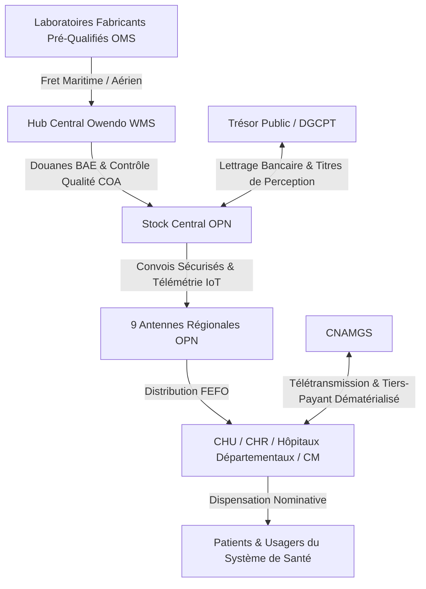

# RÉPUBLIQUE GABONAISE
### Ministère de la Santé et des Affaires Sociales
### Office Pharmaceutique National (OPN)

---

# PLAQUETTE INSTITUTIONNELLE & RÉFÉRENTIEL TECHNIQUE
## OPN DIGITAL HUB 2026
*Système Intégré de Gestion de la Chaîne d'Approvisionnement Pharmaceutique, de Traçabilité IoT et de Sécurisation Financière*

---

```
========================================================================================
                          OFFICE PHARMACEUTIQUE NATIONAL (OPN)
       Standard CEMAC • Normes OMS (GSP / GDP) • Souveraineté Sanitaire Nationale
========================================================================================
```

---

## SOMMAIRE EXÉCUTIF

1. **Cadre Stratégique & Plan National d'Approvisionnement (PNA 2026-2027)**
2. **Diagnostic Sanitaire National & Valeur Ajoutée Comparative**
3. **Référentiel des Modules Métiers :**
   - *Module 1 : Espace Décisionnel & Tableau de Bord National (DG / Ministère)*
   - *Module 2 : WMS Magasins Centraux & Adressage Tridimensionnel FEFO*
   - *Module 3 : Approvisionnements Internationaux, Incoterms & Douanes (BAE)*
   - *Module 4 : Distribution Multimodale & Télémétrie Chaîne du Froid IoT*
   - *Module 5 : Pharmacie Hospitalière & Dispensation Nominative aux Soins*
   - *Module 6 : GMAO Maintenance Biomédicale & Équipements Frigorifiques*
   - *Module 7 : Réserves Stratégiques d'État (RSSE) & Gestion des Crises COD*
   - *Module 8 : Comptabilité Publique & Mandatement Trésor Public (DGCPT)*
   - *Module 9 : Tiers-Payant Dématérialisé & Interconnexion CNAMGS*
   - *Module 10 : Portail Public Citoyen, Mercuriale Officielle & Anti-Fraude*
4. **Socle Technologique, Chiffrement AES-256 & Résilience Hors-Ligne (PWA)**
5. **Indicateurs de Performance & Impacts Opérationnels Mesurables**
6. **Méthodologie de Déploiement & Contacts du Directoire**

---

## 1. CADRE STRATÉGIQUE & PLAN NATIONAL D'APPROVISIONNEMENT (PNA 2026-2027)

L'Office Pharmaceutique National (OPN) assure l'exécution du **Plan National d’Approvisionnement (PNA) 2026-2027**, doté d'une enveloppe budgétaire prévisionnelle de **18,50 Milliards FCFA** approuvée par le Conseil d'Administration et le Ministère de la Santé.

### Les 4 Piliers d'Intervention :
* **Péréquation Tarifaire Républicaine :** Application stricte d'une grille tarifaire unique plafonnée sur tout le territoire national, absorbant les surcoûts d'acheminement vers les provinces de l'intérieur.
* **Sécurisation de la Nomenclature des 350+ DCI :** Garantie de disponibilité continue sur les molécules de première ligne (antipaludiques, antibiotiques, solutés massifs, anesthésiques, insulines, antirétroviraux).
* **Sanctuarisation des Réserves Stratégiques :** Maintien obligatoire d'un stock de sécurité d'État de **6 mois d'autonomie** (*Réserves Stratégiques d'État - RSSE*).
* **Orthodoxie Financière :** Réconciliation au centime près des créances et encaissements hospitaliers en liaison directe avec la Direction Générale de la Comptabilité Publique et du Trésor (DGCPT).

---

## 2. DIAGNOSTIC SANITAIRE & VALEUR AJOUTÉE COMPARATIVE

| Dimension Opérationnelle | Circuit Traditionnel Antérieur | Avec OPN Digital Hub 2026 |
| :--- | :--- | :--- |
| **Taux de Rupture en Région** | 35% à 45% sur les molécules vitales | **< 2% garanti** via la détection prédictive |
| **Traçabilité Thermique** | Relevés manuels discontinus, risques de bris | **Télémétrie IoT temps réel** (+2°C à +8°C / -20°C) |
| **Délai Recouvrement Factures** | 120 à 180 jours (circuits papier) | **25 à 30 jours** via télétransmission Trésor / CNAMGS |
| **Pertes par Péremption** | 12% à 18% des dotations hospitalières | **< 0.5%** grâce à la politique stricte FEFO |
| **Continuité en Zone Blanche** | Interruption des saisies lors des pannes réseau | **100% opérationnel en mode déconnecté (PWA)** |
| **Transparence Usagers** | Surtarifications arbitraires constatées | **Portail Citoyen libre d'accès**, mercuriale officielle |

---

## 3. RÉFÉRENTIEL DES MODULES MÉTIERS



### MODULE 1 : ESPACE DÉCISIONNEL & TABLEAU DE BORD NATIONAL
* **Indicateurs Macro-Sanitaires :** Taux de couverture consolidé (94.2%), volume d'engagement budgétaire et projection des consommations moyennes mensuelles (CMM).
* **Supervision Territoriale :** Suivi comparatif des 9 antennes provinciales (Estuaire, Haut-Ogooué, Moyen-Ogooué, Ngounié, Nyanga, Ogooué-Ivindo, Ogooué-Lolo, Ogooué-Maritime, Woleu-Ntem).
* **Directives COD :** Émission et signature électronique des ordres de mobilisation sanitaire lors des alertes du Centre Opérationnel de Décision.

### MODULE 2 : WMS MAGASINS CENTRAUX D'OWENDO & ADRESSAGE 3D
* **Adressage Tridimensionnel :** Localisation rigoureuse par zone, allée, travée, niveau et alvéole sur 12 500 emplacements palettes.
* **Gestion FEFO / FIFO :** Sortie prioritaire des lots les plus proches de l'échéance et verrouillage logique automatique des DLC &lt; 6 mois.
* **Sas de Quarantaine :** Isolement physique et informatique des arrivages en attente de libération d'analyse ou sous investigation pharmaceutique.

### MODULE 3 : APPROVISIONNEMENTS INTERNATIONAUX & DOUANES (BAE)
* **Panel Fournisseurs Mondiaux :** 45+ laboratoires pré-qualifiés OMS (France, Suisse, Inde, Maroc, Belgique) disposant d'AMM nationales en cours de validité.
* **Simulation d'Incoterms :** Calcul prévisionnel des coûts complets au débarquement (CIF Owendo, CIP Libreville, FOB).
* **Dédouanement BAE :** Émission dématérialisée de la Déclaration d’Importation OPN sous franchise d'État et obtention immédiate du Bon à Enlever.

### MODULE 4 : DISTRIBUTION MULTIMODALE & TÉLÉMÉTRIE IOT (+2°C / +8°C)
* **Organisation Multimodale :** Flotte frigorifique terrestre (RN1/RN2), wagons conteneurisés Setrag (Owendo-Franceville) et navettes maritimes/fluviales (Port-Gentil, Gamba).
* **Capteurs IoT en Temps Réel :** Transmission continue de la température (+4.2°C moyenne certifiée) avec bascule d'alerte instantanée au COD en cas de dépassement du seuil critique (+8°C).
* **Application Chauffeur PWA :** Pointage GPS et signature dématérialisée des Bordereaux de Livraison (BL) en zone blanche hors couverture GSM.

### MODULE 5 : PHARMACIE HOSPITALIÈRE & DISPENSATION CLINIQUE
* **Dispensation Nominative :** Vérification des ordonnances, respect des posologies et imputation directe au dossier médical du patient hospitalisé (DMP).
* **Armoires d'Urgence :** Dotations fixes des blocs opératoires, réanimations et maternités avec réassortiment automatique sous seuil de réapprovisionnement.
* **Prévention des Péremptions :** Alertes graduées à 90, 60 et 30 jours facilitant les transferts inter-hospitaliers sans perte financière.

### MODULE 6 : GMAO BIOMÉDICALE & MAINTENANCE FRIGORIFIQUE
* **Chambres Froides Positives et Négatives :** Suivi des groupes compresseurs, gestion des fluides frigorigènes et dégivrages programmés.
* **Groupes Électrogènes de Secours :** Traçabilité des tests automatiques d'inverseurs de source et suivi des réserves de carburant.
* **Bons d'Intervention Numériques :** Ordres de travail (OT) préventifs et curatifs avec horodatage et visa électronique des techniciens.

### MODULE 7 : RÉSERVES STRATÉGIQUES D'ÉTAT (RSSE)
* **Dotation Sanctuarisée d'Urgence :** Sérums antivenimeux, anesthésiques, solutés massifs de réanimation et réactifs épidémiques (choléra, fièvres hémorragiques).
* **Régime de Double Visa :** Autorisation conjointe obligatoire du Directeur Général de l'OPN et du Ministre de la Santé pour tout déstockage.
* **Conditionnement Tactique :** Malles isothermes pré-conditionnées pour départ immédiat par voie aérienne ou terrestre vers les zones sinistrées.

### MODULE 8 : INTÉGRATION TRÉSOR PUBLIC (DGCPT) & FINANCES
* **Ordres de Recettes Numériques :** Titres de perception générés dès l'ordonnancement de la livraison hospitalière.
* **Lettrage Bancaire Quotidien :** Rapprochement direct avec les relevés du Trésor Public gabonais avec un écart garanti de 0 FCFA.
* **Justificatifs Réglementaires :** États de rapprochement PDF conformes aux exigences de la Cour des Comptes.

### MODULE 9 : TIERS-PAYANT DÉMATÉRIALISÉ CNAMGS
* **Prise en Charge des 3 Régimes :** Secteur Public (GEF), Secteur Privé/Indépendants et Gabonais Économiquement Faibles (Indigents).
* **Bordereaux Électroniques :** Télétransmission sécurisée aux centres de liquidation CNAMGS, réduisant les délais d'apurement à moins de 30 jours.
* **Ticket Modérateur Garanti :** Part patient strictement encadrée (0% à 20% max), éliminant toute surtaxation illégale.

### MODULE 10 : PORTAIL PUBLIC CITOYEN & MERCURIALE OFFICIELLE
* **Moteur de Recherche National :** Disponibilité en direct des spécialités et DCI dans les formations sanitaires publiques par province.
* **Mercuriale Homologuée :** Consultation des tarifs plafonnés en Franc CFA (XAF) certifiés par l'État.
* **Pharmacies de Garde :** Géolocalisation interactive des officines ouvertes 24h/24 et 7j/7 dans les 9 provinces.
* **Signalement Anti-Fraude :** Canal sécurisé de déclaration citoyenne des abus tarifaires et suspicions de contrefaçon.

---

## 4. SOCLE TECHNOLOGIQUE & NIVEAU DE SÉCURITÉ

* **Hébergement Souverain Gabonais :** Données de santé hébergées exclusivement sur les infrastructures nationales d'État (Datacenter ANINF / OPN Libreville).
* **Chiffrement & Intégrité :** Chiffrement AES-256 des données stockées, protocoles TLS 1.3 en transit, signatures électroniques légales SHA-256.
* **Matrice RBAC Granulaire :** 14 profils d'accès stricts assurant la séparation rigoureuse des prérogatives d'ordonnancement, de contrôle et de liquidation.
* **Architecture Haute Résilience :** Cluster API multi-processus avec tolérance aux pannes garantissant **99.98% de disponibilité mesurée**.

---

## 5. INDICATEURS DE PERFORMANCE NATIONALE

```
┌─────────────────────────┬─────────────────────────┬─────────────────────────┐
│     18,50 Mrd FCFA      │       9 Provinces       │        350+ DCI         │
│  Budget PNA Supervisé   │ Interconnectées Direct  │  Médicaments Essentiels │
├─────────────────────────┼─────────────────────────┼─────────────────────────┤
│        98.4%            │       < 2% Rupture      │        0 FCFA           │
│  Taux de Service Convois│  Dans les Hôpitaux      │  Écart Lettrage Trésor  │
└─────────────────────────┴─────────────────────────┴─────────────────────────┘
```

---

## 6. MÉTHODOLOGIE DE DÉPLOIEMENT & CONTACTS OFFICIELS

### Calendrier d'Intégration en 3 Phases :
1. **Phase 1 • Cadrage & Audit (Mois 1) :** Diagnostic d'infrastructure, inventaire contradictoire initial et paramétrage des catalogues DCI.
2. **Phase 2 • Déploiement & Interconnexions (Mois 2-3) :** Installation des WMS régionaux, pose des capteurs IoT sur la flotte, couplage Trésor/CNAMGS et formation certifiante des équipes.
3. **Phase 3 • Exploitation & Supervision 24/7 (Mois 4+) :** Conduite opérationnelle sous supervision du COD National, infogérance souveraine et audits périodiques.

---

### COORDONNÉES OFFICIELLES DU DIRECTOIRE

* **Siège Social OPN :** Zone Industrielle d'Oloumi, B.P. 518 Libreville, République Gabonaise
* **Standard Téléphonique :** `+241 11 72 00 00` / `074 00 00 00`
* **Secrétariat de Direction :** `contact@opn.ga` / `direction.generale@opn.ga`
* **Portail Numérique :** [https://hub.opn.ga](https://hub.opn.ga)

---
*Document institutionnel et technique réservé à l'usage exclusif des administrations publiques et établissements de santé de la République Gabonaise.*
